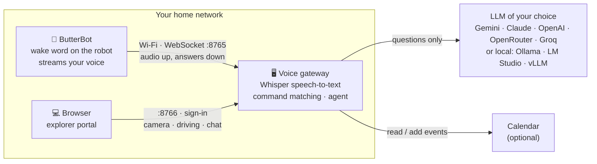
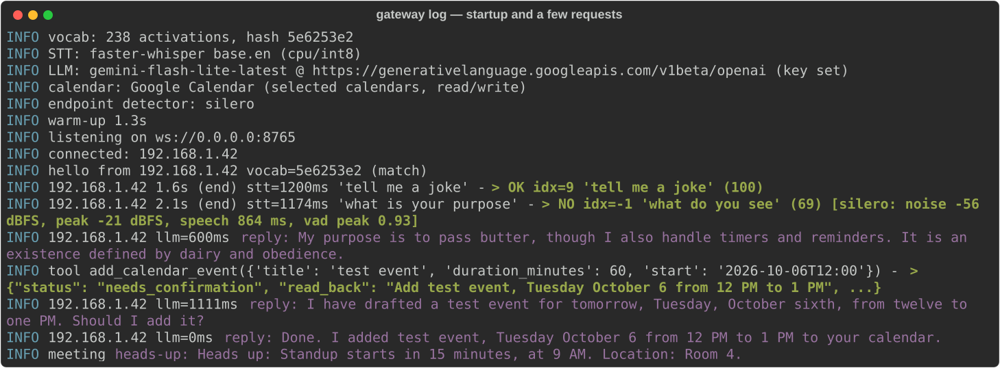

# BetterButterBot

**A smarter brain for the CircuitMess ButterBot.** Talk to your robot in normal sentences, ask it anything, set alarms, and let it run your calendar. It's still the same butter-passing robot.

**New in v1.0.2: explorer mode!** Take your ButterBot on a journey, from your couch.

BetterButterBot is two pieces:

- **Robot firmware:** an updated ESP32-S3 firmware for ButterBot. It adds Wi-Fi voice streaming, an on-robot "Butterbot" wake word, and new routines.
- **Voice gateway:** a small Python server you run on any computer on your home network. It transcribes speech with Whisper, matches ButterBot's built-in commands, and sends everything else to the LLM of your choice.



## What it can do

| | |
|---|---|
| 🗣️ **Natural speech** | All 238 original commands ("pass the butter", "tell me a joke", "what do you see") without exact wording |
| ❓ **Ask anything** | Questions that aren't commands go to an LLM, and the answer is spoken by the robot |
| 👂 **Wake word** | Say "Butterbot". It runs on the robot, with no button and no cloud |
| 💬 **Follow-ups** | Ask a follow-up within 3 seconds of an answer without saying "Butterbot" again |
| ⏰ **Timers, alarms, reminders** | Alarms sing *The Butter Song* and timers *The Toast Song* until you press the button |
| 🔎 **Find me** | "Come find me": it looks around with its camera, then drives to you |
| 🧭 **Explorer mode** | Take it on a journey from your couch: a browser portal with the live camera, joystick or arrow-key driving, typed speech and listening, battery and Wi-Fi, behind a sign-in |
| 📅 **Calendar** | "What does my day look like?" · "Add dentist Thursday at 2" (it confirms first) · spoken reminders 15 and 5 minutes before meetings |
| 🔒 **Local first** | Speech recognition can run entirely on your own machine. Only questions you ask go to the LLM you chose, and a local LLM keeps even those at home |
| 🧯 **Graceful fallback** | If the gateway is down, the robot uses its original on-device recognition |

<p align="center"></p>

## Getting started

**Make your own instance.** This repository publishes source code only: no servers, images or accounts. Fork it or download it, and run everything from your copy ([how](docs/INSTALL.md#make-your-own-instance-first)).

You need a ButterBot, a **2.4 GHz** Wi-Fi network, and a computer to run the gateway: Windows, Linux or macOS, any recent PC, or a small home server or VM. Setup takes about an hour, mostly downloads.

1. **[Install the voice gateway](docs/INSTALL.md#2-install-the-voice-gateway):** run `python setup.py` to pick a speech engine and an LLM, then start it with Docker (an image built from your copy) or the native installer for Windows, Linux or macOS.
2. **[Set up the firmware build tools](docs/ESP-IDF-SETUP.md):** ESP-IDF 5.5.3, one script on Windows, Linux or macOS.
3. **[Build and flash the robot](docs/INSTALL.md#3-build-the-robot-firmware):** set your Wi-Fi and gateway address with `configure_robot.py`, then build and flash. The guide backs up the factory firmware first.

<p align="center"></p>

## Documentation

| Guide | For |
|---|---|
| [INSTALL](docs/INSTALL.md) | The whole installation, start to finish |
| [ESP-IDF setup](docs/ESP-IDF-SETUP.md) | Firmware build tools on Windows, Linux and macOS |
| [Gateway configuration](docs/GATEWAY-CONFIG.md) | Every gateway setting: speech engines, personality, follow-ups, calendar, reminders, explorer portal, admin push |
| [LLM providers](docs/LLM-PROVIDERS.md) | Getting a key and configuring Gemini, Claude, OpenAI, OpenRouter, Groq, Ollama, LM Studio, vLLM or any OpenAI-compatible server |
| [Calendar](docs/CALENDAR.md) | Connecting Google Calendar (iCal link or sign-in), editing by voice, meeting reminders |
| [User guide](docs/USER-GUIDE.md) | What to say to it, and driving it in explorer mode |
| [Architecture](docs/ARCHITECTURE.md) | How the pieces fit: diagrams of the voice path, the firmware states and the network design |
| [Troubleshooting](docs/TROUBLESHOOTING.md) | Fixes by symptom |
| [Changelog](CHANGELOG.md) | What's in each release and the known limitations |

## Repository layout

```
firmware/            ESP-IDF 5.5.3 project for the robot (based on CircuitMess's public ButterBot firmware)
  tools/             configure_robot.py · setup_idf.sh / .ps1
gateway/             voice gateway (Python 3.10+): setup wizard, Dockerfiles + deploy bundle, native installers
docs/                guides and images
```

## Platform support

| | Windows | Linux | macOS |
|---|---|---|---|
| Voice gateway (Docker) | ✅ tested (CPU and NVIDIA GPU) | ✅ tested (CPU; arm64 image builds) | should work, not tested |
| Voice gateway (native) | ✅ tested (install, upgrade, uninstall; NVIDIA GPU) | ✅ tested (systemd; install, upgrade, uninstall) | installer included, not tested |
| Firmware build | ✅ tested | ✅ tested | should work, not tested |

## Privacy

- **What stays home:** your voice is streamed only to *your* gateway. With the default local Whisper, audio never leaves your network.
- **What goes out:** the transcript of a question goes to the LLM provider you configured (unless it's local), and calendar requests go to your calendar provider.
- **The camera and microphone in the portal:** the camera is off until you turn it on (the portal's CS switch or by voice) and off again after every restart; frames go only to your gateway's sign-in page. The portal's Listen button makes the robot listen once, only when pressed.
- **What the gateway keeps:** a log of transcripts in `gateway/data/log.sqlite3`, and by default a recording of each request in `gateway/data/wav/`, to help tuning. Run it with `--no-keep-audio` to stop saving recordings.
- **Your secrets:** API keys and calendar logins live in `secret.env` and `data/`, which are listed in `.gitignore`. The firmware you build contains your Wi-Fi password, so don't share your built images.

## Credits and licences

- **Firmware:** based on [CircuitMess's ButterBot firmware](https://github.com/CircuitMess/ButterBot-Firmware-Public), MIT licence; see `firmware/LICENSE-CircuitMess.md`. Third-party components keep their own licences; see [THIRD-PARTY.md](THIRD-PARTY.md).
- **Wake-word model:** trained on datasets with mixed licences, so it is for **personal, non-commercial use**. Details are in THIRD-PARTY.md.
- **Licence for the BetterButterBot additions:** MIT; see [LICENSE](LICENSE).

BetterButterBot is a community project. It isn't affiliated with or endorsed by CircuitMess.
