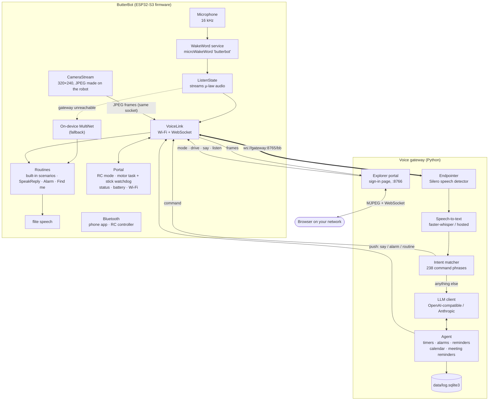
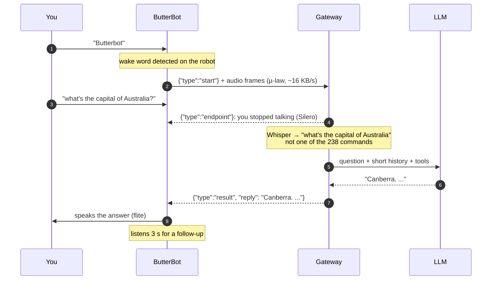
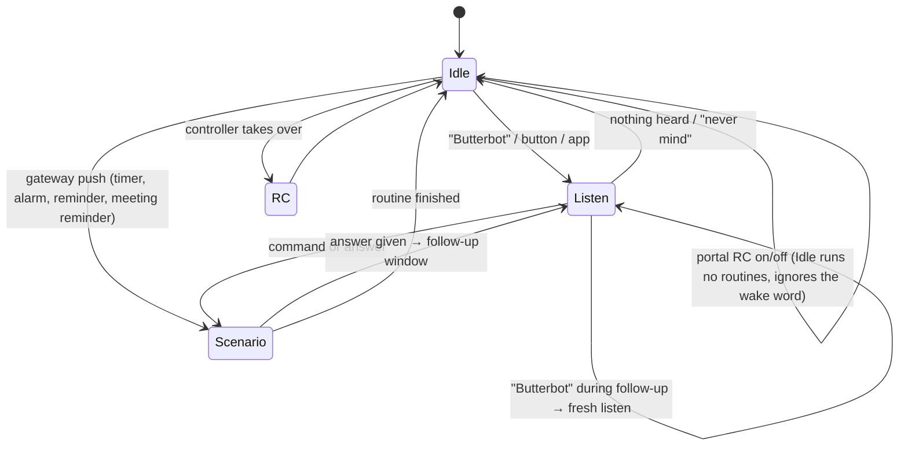
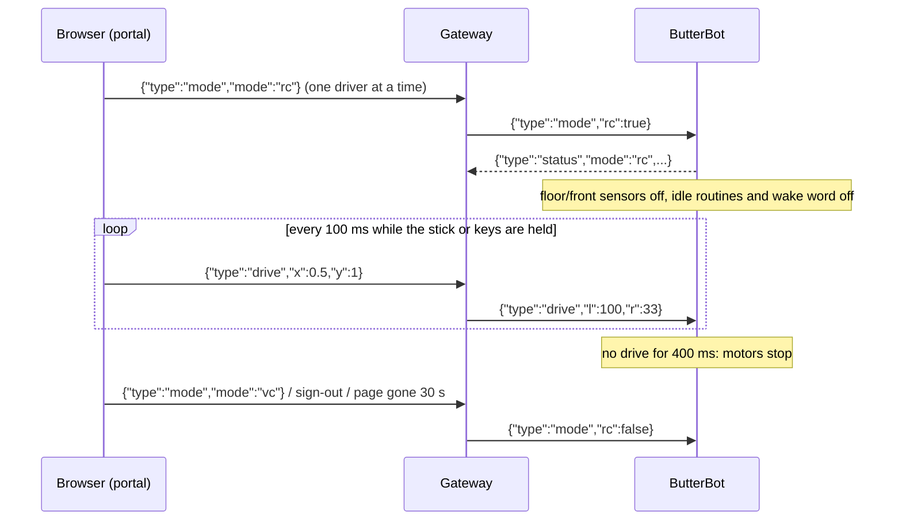
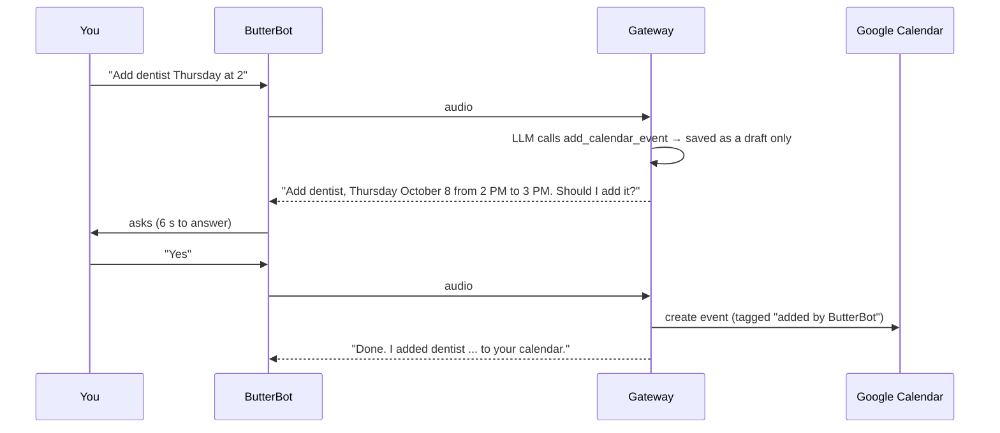

# How BetterButterBot works

## The pieces

## A question, start to finish

Built-in commands skip the LLM: the gateway returns the command's index, and the robot runs the same routine its on-device recognition would have triggered. If the gateway can't be reached, or speaks a different command list (checked with a vocabulary hash at connect), the robot falls back to its on-device MultiNet recognition.

## The robot's states

- **Wake word:** runs only in Idle. During a follow-up window, the listening audio is fed to it as well, so saying "Butterbot" starts a fresh question in under a second.
- **Pushes from the gateway** wait until the robot is idle, so an alarm never cuts into a conversation.
- **What each push does:** alarms sing The Butter Song, timers sing The Toast Song, reminders are spoken, and "find me" starts the controller's Summon routine. At connect the robot lists which songs and routines its firmware has, so the gateway falls back to speech (or says it can't) for older firmware.

## The camera stream

- **One camera, one owner at a time.** Face detection and object recognition use small 128×128 RGB frames; the stream switches the camera to 320×240 raw frames, which the robot compresses to JPEG itself (about 2–3 frames a second). A routine that needs the camera (find me, face recognition, object recognition) claims it for its whole run, from loading its model to unloading it: the stream pauses once, the routine has the camera to itself, and the stream resumes afterwards if it's still wanted.
- **Long-range find me.** The face detector shrinks every frame to ~160×120, so its range is set by that size, not the camera's. Find me switches the camera to 320×240 and also runs the detector on three full-detail 160×120 crops, which doubles the size faces appear at. Owner recognition keeps the 128×128 path its faces were registered with.
- **Why not the camera's own JPEG?** On this robot it doesn't hold up: at 640×480 frames arrived truncated, and at 320×240 the driver dropped nearly every frame for a missing end marker, even with a slower camera clock. The robot's own compression is what CircuitMess's RC feed uses too.
- **Frames ride the voice socket** as a `{"type":"frame"}` header plus a binary message, so the robot never listens on the network. Frames pause while you're talking to it, and the resolution steps down on its own if Wi-Fi can't keep up or frames arrive incomplete.
- **The gateway serves the portal** behind a sign-in (scrypt-hashed passwords, HttpOnly session cookie, lockout after repeated failures). The stream is never restored: it is off after the robot or the gateway restarts, and when the robot's connection drops.

## Explorer mode

- **The gateway mixes the stick.** Stick position becomes track speeds (forward plus turn, scaled together so a diagonal keeps its direction) after a round dead zone; a push within a few degrees of an axis goes exactly along it. Only the driver's messages reach the robot.
- **Motors on their own task.** In RC the motors, the sensor switch and the 400 ms stick watchdog run on a task of their own on the robot, not on the network task, so a stalled connection can't keep the robot driving.
- **No restrictions in RC.** The floor and front sensors are switched off on the base board for the whole of RC and back on (with a fresh reading) when it ends; charging doesn't block driving either. The robot's button, a dropped link or a restart always return it to VC.
- **Chat.** Typed text is a `say` push, spoken word for word. Listen is a `listen` push: the robot streams once with `"chat":true` and the gateway returns the transcript to the page that asked, without matching commands or asking the LLM. The robot reports `speaking` / `listening` so the page never listens while it talks.
- **Battery and Wi-Fi.** The robot reports its level (taken only after 5 s parked, because the motors dip the voltage; not measurable while charging) and RSSI after each connect, every minute, every 5 s in RC, and when the charger is plugged in or out.

## Changing your calendar by voice

- **Moves and deletes** follow the same draft-then-confirm path. The gateway refuses them for any event without ButterBot's private tag, so events you created yourself can't be changed by voice.
- **Drafts expire** after 2 minutes.

## Network design notes

- **One radio, shared.** The ESP32-S3 shares a single radio between Wi-Fi and Bluetooth. Constant Bluetooth advertising was found to stall the Wi-Fi link for 10–15 s at a time. So while the gateway link is up, the firmware **pauses Bluetooth advertising** (`CONFIG_BB_BLE_QUIET_ON_LAN`). Devices already connected stay connected.
- **Separate send and receive locks.** The WebSocket client sends and receives under separate locks (`CONFIG_ESP_WS_CLIENT_SEPARATE_TX_LOCK`), so a slow audio upload can't block the gateway's replies.
- **Enough receive buffers for explorer mode.** With the camera sending frames and the joystick streaming commands in, the original 2 Wi-Fi receive buffers ran out and wedged the link until a restart. The firmware now allows 8 (`CONFIG_ESP_WIFI_DYNAMIC_RX_BUFFER_NUM`); they are only allocated while packets arrive.
- **Self-healing connection.** A watchdog rebuilds the WebSocket client if Wi-Fi is up but the gateway has been unreachable for 20 s, or right after Wi-Fi rejoins.
- **Sustained sensor readings.** The treads' speed difference makes the robot bounce, so the firmware only passes on a "floor lost" after 4 s and a "something close" after 0.5 s without a break (`FloorLostConfirmMs`, `FrontCloseConfirmMs` in `BaseBoard.h`). A return to normal goes through at once. Start checks need 3 unsafe readings in a row, and "upright" averages 8 accelerometer samples (the speaker and leftover bounce shook single samples). A real lift keeps the floor lost and still stops it.
- **Internal RAM is tight** (about 30 KB free while running). Audio buffers and task stacks live in PSRAM. Speech recognition on the robot (MultiNet) needs Wi-Fi's memory, so the robot drops Wi-Fi while it uses on-device recognition.

## Flash layout

| Partition | Offset | Size | Contents |
|---|---|---|---|
| nvs | 0x9000 | 24 KB | settings |
| factory | 0x10000 | 8880 KB | the firmware (stock was 99.6 % full; grown to fit) |
| model | 0x8bc000 | 2990 KB | on-device speech models (srmodels) |
| storage | 0xba8000 | 212 KB | sound clips, including The Butter Song and The Toast Song (about 2 KB left) |
| human_face_det / feat | 0xbdd000 / 0xc0f000 | 200 KB / 1265 KB | face detection models |
| objdet | 0xd4c000 | 2660 KB | object detection model |
| wakeword | 0xfe5000 | 64 KB | the "butterbot" model (new) |
