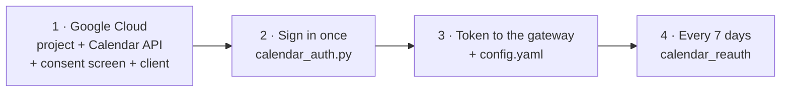
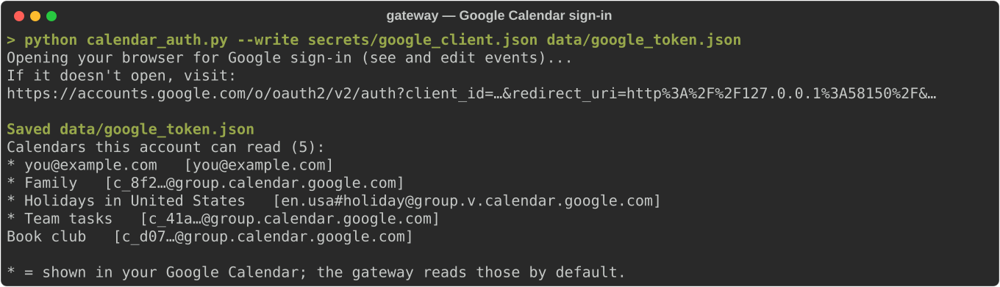

# Calendar

ButterBot can read your calendar ("what does my day look like?"), add and change events after asking you to confirm, and remind you before meetings. All of it runs on the voice gateway; the robot firmware doesn't change.

**You connect your own calendar through your own Google Cloud project** (or, read-only, your own iCal link). This project provides no calendar links, Google projects, client files or tokens, and there is no shared sign-in: never use one someone else made. Everything below is created in *your* calendar account and stays on *your* gateway (`secret.env`, `secrets/` and `data/`, which git never publishes).

## Pick a connection

| | Google Cloud project (recommended) | iCal link |
|---|---|---|
| Works with | Google Calendar | Google, Outlook, iCloud, Fastmail, anything that publishes an `.ics` link |
| Read your day | ✓ | ✓ |
| Ask about one named calendar | ✓ (hidden calendars too) | ✓ |
| Add / move / delete events by voice | ✓, with a yes/no confirmation; only events ButterBot added can be moved or deleted | ✗ |
| Meeting reminders | ✓ | ✓ |
| Setup | 15 minutes: your own Google Cloud project and one browser sign-in | 2 minutes |
| Upkeep | sign in again every 7 days*; ButterBot warns you the day before | none |
| Security | only your gateway can use it; revoke any time in your Google account | anyone holding the link can read the calendar |

\* Google expires sign-ins after 7 days for apps that are still in "Testing" status. Leaving Testing requires a website and privacy policy on a domain you own.

---

## Option A: your own Google Cloud project

ButterBot talks to the Google Calendar API through an app that **you** create in **your** Google account. It's free (no billing account), private to you, and takes about 15 minutes once:




### 1. Create your own Google Cloud app (once)

This app is yours alone: it only lets your own gateway reach your own calendar. It costs nothing, needs no billing and no website. In [Google Cloud Console](https://console.cloud.google.com), signed in with the Google account whose calendar ButterBot should use:

1. **Create a project.** Use the project picker at the top → *New project*, with any name (for example "ButterBot").
2. **Enable the Calendar API.** *APIs & Services → Library* → search **Google Calendar API** → *Enable*.
3. **Set up the consent screen** under *Google Auth Platform* (older consoles: *APIs & Services → OAuth consent screen*):
   - **Branding:** set an app name and your email as the support and developer-contact email. Leave the app domain, home page, privacy policy and authorized-domain fields **empty**.
   - **Audience:**
     - Choose user type **External**.
     - Under **Test users**, add your Google account. Without this, sign-in fails with *"Access blocked: … has not completed the Google verification process"*.
     - Leave the publishing status on **Testing**.
4. **Create the OAuth client.** *Clients → Create client* → type **Desktop app** → *Create* → **Download JSON**. Save it as `gateway/secrets/google_client.json`.

The JSON contains a client secret. It lives in `secrets/`, which `.gitignore` keeps out of git, so don't commit it or post it anywhere. Each person who sets up a ButterBot makes their own; never share yours.

### 2. Sign in (on any computer with a browser)

From the `gateway` folder:

```
python calendar_auth.py --write secrets/google_client.json data/google_token.json
```

Leave out `--write` for read-only access. In the browser:

1. Choose your account.
2. On *"Google hasn't verified this app"*, click **Advanced → Go to <your app> (unsafe)**. This is expected: it's your own app, which Google hasn't reviewed.
3. **Leave both boxes ticked:** *See and download any calendar…* and *View and edit events…*. The edit permission alone can't list your calendars.
4. When the page says *"ButterBot: calendar access granted"*, close the tab.

<p align="center"></p>

### 3. Point the gateway at the token

1. **Put `google_token.json` in the gateway's data folder.**
   - Docker, or a native install on Windows or macOS: `gateway/data/`
   - Linux native: `/opt/bb-voice-gateway/data/`
   - If you signed in on a different machine, copy the file over.
2. **Add this to `config.yaml`, then restart the gateway:**
   ```yaml
   calendar:
     provider: google
     token_file: google_token.json   # in the data folder
     calendars: selected             # the calendars ticked in Google Calendar | primary | [ids]
     write_calendar: primary         # where new events go unless you name a calendar
   ```

The log should show `calendar: Google Calendar (selected calendars, read/write)`.

### 4. Every 7 days: renew

ButterBot warns you out loud a day before the sign-in runs out ("Heads up: my Google Calendar sign-in runs out tomorrow at …"), and once a day after it has expired, between 9 AM and 9 PM. Asking for your calendar after it expired also gets "Your calendar login has expired…". If your Google app is published (no 7-day limit), set `token_days: 0` under `calendar:` to turn the warning off. Renewing signs in again and puts the new token where the gateway reads it; **no restart is needed**:

| Gateway runs | Windows | Linux / macOS |
|---|---|---|
| on another machine | `powershell -ExecutionPolicy Bypass -File calendar_reauth.ps1 -GatewayHost user@<gateway-ip>` | `./calendar_reauth.sh user@<gateway-ip>` |
| on this machine | `… calendar_reauth.ps1 -GatewayHost local` | `./calendar_reauth.sh local` |

The remote option uses `ssh`/`scp`, so set up SSH access to the gateway machine first. To skip the host argument each time, set `BB_GATEWAY_SSH` once.

To revoke access at any time: Google Account → *Security* → *Third-party apps & services*.

### If sign-in goes wrong

| What you see | Fix |
|---|---|
| *"Access blocked: … has not completed the Google verification process"* | Add your account under **Audience → Test users** (step 1), then sign in again. |
| *"Google hasn't verified this app"* | Expected for your own app: **Advanced → Go to <your app> (unsafe)**. |
| `Google returned no refresh token` | Remove the app at Google Account → *Security* → *Third-party apps & services*, then run the sign-in again. |
| The gateway log says `invalid_grant` / "calendar login expired" | The 7-day sign-in ran out: renew (step 4). |
| `OAuth client JSON not found` | Save the downloaded file as `gateway/secrets/google_client.json` (step 1.4). |
| ButterBot can't find a calendar you name | With `calendars: selected`, only calendars ticked in Google Calendar's left-hand list are read. Tick it, or list its id under `calendars:`. |
| *"edit access was not granted"* | Sign in again and leave **both** boxes ticked. |

---

## Option B: iCal link (read-only)

No Google Cloud project needed, but ButterBot can only read: it can't add, move or delete events.


### 1. Create your link

Make one link per calendar you want ButterBot to read.

| Calendar service | Where to get it |
|---|---|
| **Google Calendar** (web) | ⚙ **Settings** → under *Settings for my calendars*, click the calendar → **Integrate calendar** → copy **Secret address in iCal format**. Use the *secret* address, not the *public* one: the public one only works if the calendar is made public. Calendars others share with you have their own secret address under *Settings for other calendars*, if the owner allows it. |
| **Outlook.com / Microsoft 365** (web) | ⚙ **Settings** → **Calendar** → **Shared calendars** → *Publish a calendar* → choose the calendar and **Can view all details** → **Publish** → copy the **ICS** link (not the HTML one). Work accounts may have publishing switched off by the admin. |
| **iCloud** | On a Mac: Calendar → right-click the calendar → **Share Calendar…** → tick **Public Calendar** → copy the link. On iPhone: Calendar → **Calendars** → ⓘ next to it → **Public Calendar**. Change `webcal://` at the start to `https://`. |
| **Fastmail, Proton, Nextcloud, others** | Look for "share", "publish", "subscribe" or "export as iCal / ICS" in the calendar's settings. Any link ending in `.ics` (or giving iCal data) works. |

### 2. Check the link

Paste it into a browser's address bar. It should download a `.ics` file, or show text starting with `BEGIN:VCALENDAR`. A sign-in page or an error means the link isn't public yet.

### 3. Give it to your gateway

1. **Add it to `secret.env`**, next to `config.yaml`:
   - Native install: the install folder (Linux: `/opt/bb-voice-gateway/secret.env`).
   - Docker: the gateway folder.

   For several calendars, put the links on one line separated by spaces:
   ```
   BB_CALENDAR_ICS=https://calendar.google.com/calendar/ical/.../basic.ics https://outlook.office365.com/owa/calendar/.../calendar.ics
   ```
   `python setup.py` also asks for this, with hidden input.
2. **Restart the gateway.** With Docker, use `docker compose up -d`, not `restart`. The log should show `calendar: 2 iCal feed(s)`, or however many links you gave it.

**Treat each link like a password:** anyone who has it can read that calendar. If one leaks, reset it, which stops the old link working, and put the new one in `secret.env`:
- **Google:** *Integrate calendar* → **Reset** next to the secret address.
- **Outlook:** *Shared calendars* → **Reset links**.
- **iCloud:** untick *Public Calendar*, then tick it again.

---

## Several calendars or people

- **Several calendars, one Google account:** the Google sign-in reads every calendar ticked in Google Calendar (`calendars: selected`), including calendars other people share with that account. To include a family member's calendar, have them share it with your account.
- **Several accounts or services:** use iCal links. Put any number of links from any services on the `BB_CALENDAR_ICS` line. Each person creates their own link, and you collect them in your gateway's `secret.env`.
- **One connection per gateway:** either one Google sign-in or a set of iCal links, not both at once. To cover two Google accounts with the sign-in, share one account's calendars with the other; otherwise use iCal links for all of them.

---

## Using it

| Say | What happens |
|---|---|
| "What does my day look like?" / "Anything tomorrow?" | How many events, the first one, anything notable, your free time. Every event is read out only if there are three or fewer. |
| "What's on the book club calendar this week?" | Just that calendar. Names are matched loosely, so a misheard "book club" or "the book club calendar" still works. |
| "Add dentist Thursday at 2" | *"Add dentist, Thursday October 8 from 2 PM to 3 PM. Should I add it?"*: say **yes** within 6 s. Events are 1 hour unless you say otherwise. |
| "Add practice to the book club calendar Saturday at 9" | Same, on that calendar. Only calendars you own or can edit are allowed. |
| "Move the dentist to Friday at 3" / "Delete the dentist" | Same yes/no check. Works only on events ButterBot added; it says so if you ask about one of your own. |
| "Remind me 10 and 2 minutes before meetings" / "Turn off meeting reminders" | Changes meeting reminders. The change is remembered. |

Events ButterBot adds carry a private tag and the description "Added by ButterBot". That tag is how the gateway tells which events it may change.

**Meeting reminders:** before each timed event the robot says *"Heads up: Standup starts in 15 minutes, at 9 AM."* At 5 minutes it says *"Time to wrap up: …"*.
- All-day events, events you declined, and out-of-office or focus-time blocks are skipped.
- Events at the same time are combined into one sentence.
- Video-call links are read as "It's online".
- If the robot is off at reminder time, the reminder is retried until the meeting starts.

The reminder times are set by `calendar.remind_minutes_before` in `config.yaml` (default `[15, 5]`), or by voice.
