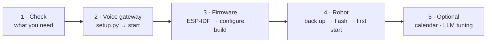
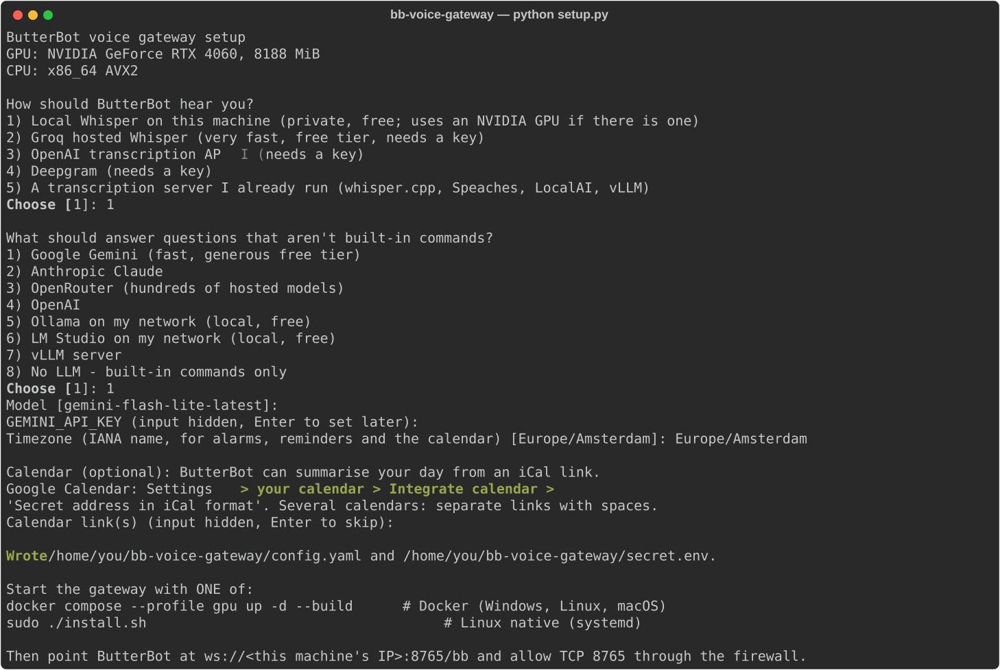
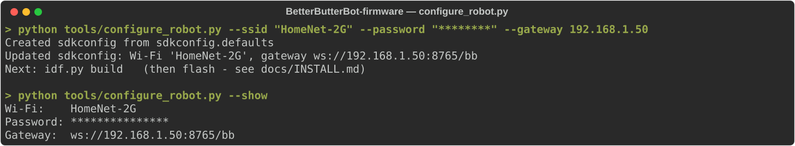
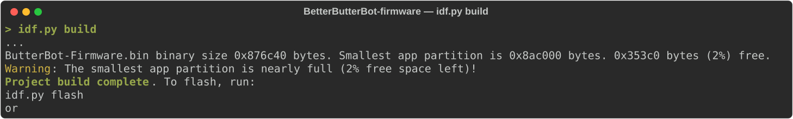
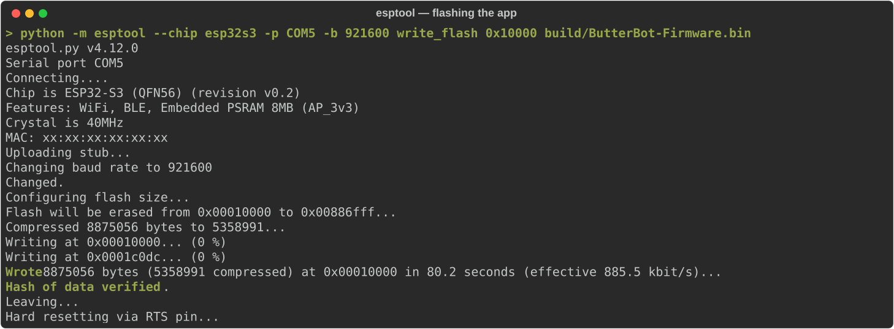
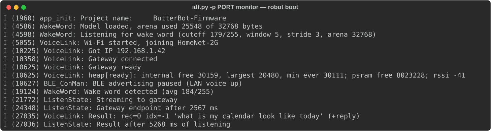

# Installing BetterButterBot

Allow about an hour, most of it waiting on downloads.



> **Before you start:** flashing replaces ButterBot's factory firmware. Step 4 makes a complete backup first, so you can always go back.

## Make your own instance first

BetterButterBot isn't a hosted service. This repository publishes source code only. It runs no servers, hosts no Docker images and holds no accounts, and your robot never talks to it. Everything you run is your own instance:

| | Yours, not this project's |
|---|---|
| **Code** | Your own copy. **Fork** the repository on GitHub, which keeps a link for pulling later releases, or download it (*Code → Download ZIP*, or a release's `source/` zips). |
| **Gateway** | Runs on your computer, from a Docker image **you build** from your copy (Option A below) or a native install. |
| **Settings and keys** | Your Wi-Fi, gateway address, LLM key and calendar sign-in live only in your copy and on your gateway. They are listed in `.gitignore`, so a fork never publishes them. |
| **Calendar** | Your own Google Cloud project and sign-in ([CALENDAR.md](CALENDAR.md)). |
| **Explorer portal** | Accounts you create on your gateway. |

**Updating** is up to you. When a new release appears on this project's Releases page, bring it into your copy (in a fork: *Sync fork* on GitHub, then `git pull`; otherwise download it again). Then re-run the gateway install and re-flash the robot.

Unpack or clone your copy somewhere short and without spaces, for example `C:\bbb` on Windows or `~/bbb` on Linux and macOS.

---

## 1. What you need

| | Requirement |
|---|---|
| **Robot** | A CircuitMess ButterBot and a USB-C **data** cable (charge-only cables won't work). |
| **Wi-Fi** | A **2.4 GHz** WPA2 network. The robot can't use 5 GHz. The robot and the gateway must be able to reach each other, so turn off "AP isolation" / "client isolation" for that network. |
| **Gateway computer** | Any computer on the same network that stays on: a PC, a Mac, a home server or a small Linux VM. 4 GB RAM is plenty. Speech recognition takes about 0.5 s per command with an NVIDIA GPU and 1.5–2 s on a modern CPU. |
| **Build computer** | Windows or Linux (macOS should work but isn't tested yet) with about 5 GB free. It can be the same machine as the gateway. |
| **LLM (optional)** | Answers questions that aren't built-in commands: a hosted API key (Gemini has a free tier) or a local model server. See [LLM-PROVIDERS.md](LLM-PROVIDERS.md). Without one, ButterBot still does all its commands, timers and alarms. |

**Choose the gateway's address now.** The robot has it built into its firmware, so give the gateway computer a fixed IP address. A DHCP reservation in your router is the easiest way. This guide calls it `<gateway-ip>`.

---

## 2. Install the voice gateway

On the gateway computer, pick **one** of the two ways to run it. Both have been tested on Windows and Linux, with and without an NVIDIA GPU.

| | Docker | Native install |
|---|---|---|
| You need | Docker (Docker Desktop on Windows/macOS) | Python 3.10+ |
| Runs as | a container that restarts by itself | a background service: systemd on Linux, a login item on macOS, a startup task on Windows |
| GPU | NVIDIA, via `COMPOSE_PROFILES=gpu` | NVIDIA, detected automatically; Apple-GPU `mlx` on Macs |
| Remove | `docker compose down` | `uninstall` script |

### Option A: Docker (recommended)

Docker builds the gateway image from your own copy of the code, on the gateway computer. In your copy's `gateway` folder:

1. **Run the setup wizard:**
   ```
   python setup.py
   ```
2. **Build and start it:**
   ```
   docker compose --profile cpu up -d --build
   ```
   Use `--profile gpu` instead if you have an NVIDIA GPU.

After an update, run the same `up -d --build` again. Everyday commands (logs, restart) are in [`gateway/docker/README.md`](../gateway/docker/README.md).

> **Running the gateway on a machine without the source?** Build the image once, then move it there. Either push it to **your own** registry (for example `docker build -t ghcr.io/<your-account>/bb-voice-gateway:cpu -f Dockerfile .` then `docker push …`), or save it to a file (`docker save bb-voice-gateway:cpu | gzip > bb-voice-gateway-cpu.tar.gz`, then `docker load -i` on the other machine). On that machine, the deploy bundle in [`gateway/docker/`](../gateway/docker/README.md) runs it with no source and no Python.

### Option B: Native install

In the repository's `gateway` folder:

| Windows (PowerShell) | Linux | macOS |
|---|---|---|
| `powershell -ExecutionPolicy Bypass -File .\install.ps1` | `sudo ./install.sh` | `./install.sh` |

The installer:
- creates a private Python environment;
- runs the setup wizard (below) if there's no `config.yaml` yet;
- installs the background service and starts it.

Re-running the installer **upgrades** in place and keeps your settings. To remove it, run `uninstall.ps1` / `uninstall.sh`, which also keep your settings unless you add `-Purge` / `--purge`.

### The setup wizard

Both options run the same wizard. It shows the GPU and CPU it found, then asks:
- **How ButterBot should hear you.** Local Whisper is private and free; the hosted services need a key.
- **What should answer questions.** Pick a provider; it then asks for the model and the key (typing is hidden).
- **Your timezone.** In Docker, type it in, because the container can't detect it.
- **Optionally, a calendar link.**

<p align="center"></p>

It writes two files:
- `config.yaml`: your choices. Every other setting is explained in [GATEWAY-CONFIG.md](GATEWAY-CONFIG.md).
- `secret.env`: your keys. Keep it private; git ignores it.

The first start downloads the speech model (75 MB to 1.6 GB). After that, the gateway runs offline, apart from a hosted LLM if you chose one.

### Open the firewall

Allow incoming **TCP port 8765** on the gateway computer:
- **Windows:** in an admin PowerShell,
  `New-NetFirewallRule -DisplayName "ButterBot gateway" -Direction Inbound -Protocol TCP -LocalPort 8765 -Action Allow -Profile Private`
- **Linux with ufw:** `sudo ufw allow 8765/tcp`

For the optional explorer portal (camera, remote control, chat), open **TCP 8766** the same way.

### Check it's running

| | Command |
|---|---|
| Docker | `docker compose ps` shows **healthy**; `docker compose logs -f` shows the log |
| Linux service | `journalctl -u bb-voice-gateway -f` |
| Windows / macOS native | the log file is `data\gateway.log` in the install folder (`%LOCALAPPDATA%\bb-voice-gateway` / `~/bb-voice-gateway`) |

The log starts with `bb-voice-gateway 1.0.1` and ends with `listening on ws://0.0.0.0:8765`. The lines between show the speech engine, the LLM (`key set` means your key was found) and the calendar.

---

## 3. Build the robot firmware

### a. Install ESP-IDF 5.5.3 (once per computer)

[ESP-IDF-SETUP.md](ESP-IDF-SETUP.md) covers Windows, Linux and macOS in detail. The short version, from the `firmware` folder:

| Windows (PowerShell) | Linux / macOS |
|---|---|
| `powershell -ExecutionPolicy Bypass -File tools\setup_idf.ps1` | `bash tools/setup_idf.sh` |
| then, in each new window:<br/>`. $env:USERPROFILE\esp\esp-idf-v5.5.3\export.ps1` | then, in each new terminal:<br/>`. ~/esp/esp-idf-v5.5.3/export.sh` |

`idf.py --version` must print **v5.5.3**.

### b. Set your Wi-Fi network and gateway address

```
python tools/configure_robot.py --ssid "<your 2.4 GHz network>" --password "<wifi password>" --gateway <gateway-ip>
python tools/configure_robot.py --show
```

<p align="center"></p>

These values are compiled into the firmware. If you change networks or move the gateway, run this again, then rebuild and re-flash.
- The settings file it writes (`sdkconfig`) holds your Wi-Fi password, so git ignores it. Don't share it or your built images.
- Optional settings, such as wake-word sensitivity, are under *ButterBot VoiceLink* in `idf.py menuconfig`.

### c. Build

```
idf.py build
```

The first build downloads the components pinned in `dependencies.lock` and takes 5–15 minutes. It ends like this:

<p align="center"></p>

The "nearly full" warning is expected: the app partition has about 5 % (450 KB) to spare. [firmware/DIAGNOSTICS.md](../firmware/DIAGNOSTICS.md) lists what was trimmed to make that room.

---

## 4. Back up and flash the robot

### The power button: read this first

ButterBot's power button is the **camera button**, and the robot only stays on while its firmware holds the power. **While the robot is being read or flashed, hold the camera button the whole time.**
- If a flash is interrupted, hold the button and run the same command again. Nothing that matters can be damaged: the bootloader that receives firmware is never overwritten.
- When the command prints `Hard resetting via RTS pin...`, let go. The robot switches off; turn it on normally by holding the button for 4–5 seconds.

### a. Find the robot's serial port

Plug in the USB cable and turn the robot on (hold the button for 4–5 s). It uses a CH340 USB-serial chip.

| OS | Port looks like | Where |
|---|---|---|
| Windows | `COM5` | Device Manager → Ports (COM & LPT) → *USB-SERIAL CH340* |
| Linux | `/dev/ttyUSB0` | `ls /dev/ttyUSB*`. On "permission denied", add yourself to the `dialout` group. |
| macOS | `/dev/cu.wchusbserial…` | `ls /dev/cu.*` |

Driver and permission details are in [ESP-IDF-SETUP.md](ESP-IDF-SETUP.md). The commands below use `PORT`; replace it with yours.

### b. Back up the factory firmware (about 3 minutes, hold the button)

From the `firmware` folder, with ESP-IDF activated:

```
python -m esptool --chip esp32s3 -p PORT -b 921600 read_flash 0 0x1000000 butterbot_stock_16MB.bin
```

Keep `butterbot_stock_16MB.bin` (16 MB) somewhere safe. It's your way back to the original firmware.

### c. Flash BetterButterBot (about 2 minutes, hold the button)

This writes everything, wake-word model included:

```
cd build
python -m esptool --chip esp32s3 -p PORT -b 921600 --before default_reset --after hard_reset write_flash "@flash_args" 0xfe5000 ../butterbot_wakeword.tflite
cd ..
```

Wait for `Hash of data verified` after each part, then `Hard resetting via RTS pin...`, then let go. For later updates that only change the program, flashing just the app takes about 80 seconds:

```
python -m esptool --chip esp32s3 -p PORT -b 921600 write_flash 0x10000 build/ButterBot-Firmware.bin
```

<p align="center"></p>

### d. First start

1. Hold the camera button for 4–5 seconds until the robot speaks.
2. Within about 15 seconds you should hear **"Network voice ready."** It has joined your Wi-Fi and reached the gateway.
3. The gateway log shows `hello from <robot-ip> … (match)`.

To see the robot's side, connect USB and run `idf.py -p PORT monitor` (exit with `Ctrl+]`):

<p align="center"></p>

No "Network voice ready"? See [TROUBLESHOOTING.md](TROUBLESHOOTING.md#it-never-says-network-voice-ready).

---

## 5. Optional extras

- **Calendar:** read your day, add events by voice, meeting reminders. See [CALENDAR.md](CALENDAR.md).
- **A different or faster LLM:** see [LLM-PROVIDERS.md](LLM-PROVIDERS.md).
- **Personality, follow-up timing, speech engines, letting other programs make it talk:** see [GATEWAY-CONFIG.md](GATEWAY-CONFIG.md).
- **Explorer mode (camera, driving and chat in a browser):** create a portal account; see [GATEWAY-CONFIG.md](GATEWAY-CONFIG.md#explorer-portal-camera).

## 6. Check that it works

| Say | Expected |
|---|---|
| "Butterbot" … "tell me a joke" | a joke (a built-in command, recognised by the gateway) |
| "Butterbot" … "what's the capital of Australia?" | a spoken answer (needs an LLM) |
| (within 3 s) "and how many people live there?" | a follow-up answer, without saying "Butterbot" |
| "Butterbot" … "set an alarm for" a time 2 minutes from now | The Butter Song at that time; press the button to stop it |
| "Butterbot" … "never mind" | it goes quiet |
| (unplugged, on the floor) "Butterbot" … "come find me" | "On my way.", then it turns until it sees you and drives over |

Then see [USER-GUIDE.md](USER-GUIDE.md) for everything else you can say.

## Going back to the factory firmware

Hold the camera button the whole time and run:

```
python -m esptool --chip esp32s3 -p PORT -b 921600 write_flash 0 butterbot_stock_16MB.bin
```
