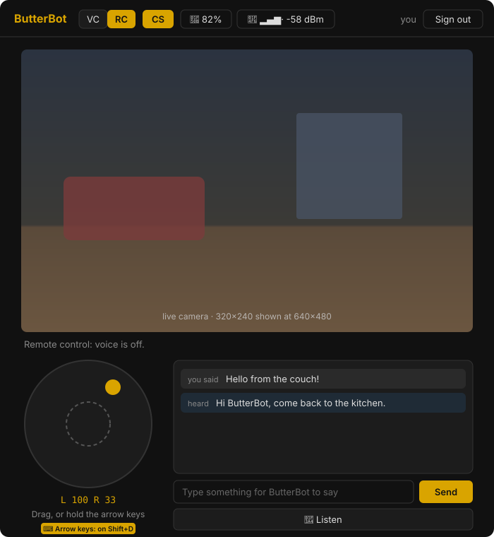

# BetterButterBot user guide

## Talking to it

1. **Say "Butterbot"**, then pause briefly. It answers with its listening sound, or "Yes?".
2. **Say what you want** in normal speech. You don't need exact wording.
3. **It answers.** For a question, it then listens for about **3 seconds** for a follow-up, so you can carry on without saying "Butterbot" again. Say "Butterbot" in that window to start fresh.

Other ways to start listening still work: a short press of the camera button, or the Listen button on the controller or phone app.

**Stop or cancel:** "never mind", "stop listening", "cancel" or "thanks, that's all".

**Start over:** "start over", "forget our conversation" or "clear your memory" makes it forget the last few exchanges (it answers "Okay, fresh start."). This works even when the LLM is slow, because the gateway handles it directly.

**Startup:** about 15 seconds after it says hello, you'll hear **"Network voice ready."** If the network drops and comes back, it says **"Network voice is back online."** Until then it understands only its original built-in commands, using the slower on-device recognition.

## Built-in commands

These are the original ButterBot commands. They now work with natural wording ("could you pass me the butter?").

| Ask | Examples |
|---|---|
| Butter | "pass the butter", "hand me the butter" |
| Jokes, facts, advice | "tell me a joke", "tell me a fact", "I need advice" |
| Time | "what time is it" |
| Dice | "roll a dice", "roll a d six" |
| Dance and move | "show me your moves", "do a dance", "move forward" |
| Camera | "what do you see", "who is this", "remember this face", "forget owner" |
| Lights module | "turn on the lights", "light strobe", "lights faster" |
| Sensor modules | "temperature report", "switch to celsius", "check air quality", "turn on intruder detection" |
| Infrared module | "learn new infrared command", "list infrared commands" |
| Phone (app connected) | "what song is playing", "next song", "list notifications" |
| Power | "shut down" |

## Questions and conversation

Anything that isn't a built-in command goes to the LLM you chose in the gateway setup:
- "What's the capital of Australia?" then "And how many people live there?"
- "Explain why the sky is blue, briefly."
- "Are you connected to the internet?"

Answers are kept short because they're spoken aloud. Without an LLM configured, these get "I didn't understand that".

## Timers, alarms and reminders

| Say | What happens |
|---|---|
| "Set a timer for 10 minutes for the pasta" | Sings *The Toast Song*, then "Your pasta timer is done." Up to 3 rounds; **press the button to stop it**. |
| "Set an alarm for 7" / "Wake me up at 6:30 for the gym" | Sings the butter song, then "Good morning! It is 6:30 AM. Time for the gym." It repeats up to 3 rounds; **press the button to stop it**. |
| "Remind me at 5 PM to call Mom" | At 5 PM: "Reminder: call Mom." |
| "What alarms do I have?" / "Cancel my 7 o'clock alarm" | Lists or cancels timers, alarms and reminders |

They're stored on the gateway, not the robot, so they survive restarts. If the robot is off when an alarm is due, the alarm is skipped after 10 minutes rather than going off late; a timer that late is spoken without the song.

## Finding you and moving

| Say | What happens |
|---|---|
| "Come find me" / "come here" / "where am I?" | "On my way." It looks around with its camera in 30° steps until it sees a face, turns to face you, then drives to you. A full look-around takes about 45 s. It sees faces up to roughly 1–1.5 m away at its own height, so it works best on a desk with you seated in front of it, facing it, in good light. On the floor it can't see a standing person's face. |
| "Turn left" / "turn right" / "turn around" / "move forward" | Moves as asked. |
| "Do a dance" | Dances. |

- **It won't move by voice while plugged in** (USB or charger counts as charging); it says so. Explorer mode has no such limit (below).
- **It stops if it's lifted or at an edge:** its bottom sensor watches the floor. It bounces a little as it moves, so single readings are ignored: it stops after 4 seconds without floor, or 0.5 s of something close in front. Very dark or glossy floors can still read as "no floor".

## Explorer mode: the robot portal

Take ButterBot on a journey from your couch. The portal is a web page served by the gateway: open `http://<gateway-ip>:8766/` in a browser on your home network and sign in. The account is created on the gateway; see [GATEWAY-CONFIG.md](GATEWAY-CONFIG.md#explorer-portal-camera).

| Control | What it does |
|---|---|
| **VC / RC** | **Voice Control** is the normal robot (it always starts in VC). **Remote Control** hands it to you: the wake word, voice commands and idle routines are off, and only the portal moves it. |
| **CS** | Camera stream on or off. Off after every restart. "Start the camera stream" / "stop the camera" by voice flip the same switch. |
| **Joystick** | Grab the knob and drag it within the ring: the further out, the faster, up to full speed at the rim. The dashed inner ring is a dead zone where it stops but you keep hold, so you can swing through the middle to reverse. Let go and it springs back and stops. |
| **Arrow keys** | **Shift+D** (or the ⌨ button) turns them on, **Esc** turns them off. Full speed only: ↑ ↓ drive, ← → spin in place, one of each for a diagonal; opposite keys cancel out. |
| **Chat** | Type a line and **Send** (or Enter): ButterBot says it out loud, word for word. **🎤 Listen** makes it listen once; what it hears appears in the chat as text and is never run as a command. It doesn't listen while it's talking. |
| **🔋 / 📶** | Battery level (measured while parked; **⚡ Charging** / **⚡ Full** on the charger) and the Wi-Fi signal at the robot, updated every minute, every 5 s in RC. Amber and red mean head back towards the router or the charger. |

**Driving in RC:**
- **One driver at a time.** Whoever switches to RC drives; everyone else signed in sees "Driven by <name>" and can watch and chat.
- **Nothing on the robot second-guesses the driver.** The floor and front sensors are off for the whole of RC, and it drives while charging too (so it can leave a charging dock). Watch the camera, mind stairs and edges, and remember the picture lags about half a second.
- **It stops by itself** when your stick or keys stop reaching it for 0.4 s: the page closed, Wi-Fi faded, or you let go.
- **Back to VC** when you press VC, sign out, short-press the robot's button (the override for anyone next to it), the connection drops, or it restarts. Closing the page without signing out hands back control after 30 seconds.

The camera sends 320×240 at about 2–3 frames a second, shown at 640×480: a look-in view, not smooth video. It pauses by itself whenever something else needs the camera ("who is this", finding you) and while it listens, and resumes afterwards.

## Calendar (if connected)

| Say | What happens |
|---|---|
| "What does my day look like?" / "Anything tomorrow?" | A short summary: how many events, the first one, anything notable, your free time |
| "What's on my book club calendar this week?" | Only that calendar. Names don't need to be exact, and hidden calendars work too |
| "Add dentist Thursday at 2" | Reads it back ("Add dentist, Thursday October 8 from 2 PM to 3 PM. Should I add it?") and adds it only after you say **"yes"**. "No" leaves your calendar alone. |
| "Move the dentist to Friday at 3" / "Delete the dentist" | Same yes/no check. It only changes events **it added itself**; your other events can't be moved or deleted by voice. |
| "Remind me 10 and 2 minutes before meetings" / "Turn off meeting reminders" | Changes the spoken meeting reminders (below) |

Adding, moving and deleting need the Google sign-in option with edit access. The iCal link is read-only.

**Meeting reminders:** before each timed event, ButterBot says "Heads up: Standup starts in 15 minutes, at 9 AM." At 5 minutes it says "Time to wrap up: Standup starts in 5 minutes."
- All-day events, declined meetings and out-of-office blocks are skipped.
- Video-call links are read as "It's online".

## The status light

- Blinks quickly while listening.
- Steady while speaking.
- Blinks slowly when idle.

## Bluetooth, the phone app and the RC controller

The robot's Wi-Fi and Bluetooth share one radio. To keep voice responses quick, **the robot stops advertising over Bluetooth while it's connected to the gateway**:
- Phones and controllers that are **already connected stay connected**.
- New ones can't find the robot until the gateway connection is down.

To pair the controller or phone app:
1. Stop the gateway for a moment, or turn the robot on while the gateway is offline.
2. Pair.
3. Start the gateway again.

When the robot drives in RC mode, voice is paused and Bluetooth advertising comes back automatically.
